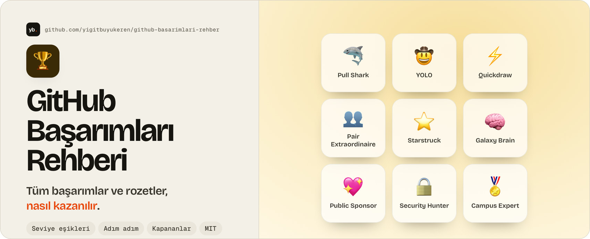

<a href="#-hızlı-tablo">
  <picture>
    <source media="(prefers-color-scheme: dark)" srcset="images/banner-dark.jpg">
    
  </picture>
</a>

<div align="center">

**[⚡ Hızlı tablo](#-hızlı-tablo)** &nbsp;·&nbsp; **[🎚️ Seviyeler](#-seviyeli-başarımlar)** &nbsp;·&nbsp; **[✨ Rozetler](#-öne-çıkan-rozetler-highlights)** &nbsp;·&nbsp; **[⚠️ Bilmen gerekenler](#-bilmen-gerekenler)**

[](LICENSE)

[](https://github.com/yigitbuyukeren/github-basarimlari-rehber/commits/main)

</div>

# 🏆 GitHub Başarımları Rehberi

GitHub profilindeki **tüm başarımların (achievements) ve rozetlerin** listesi, her birinin nasıl kazanıldığı,
seviye eşikleri ve hangilerinin artık kazanılamadığı. Türkçe, komutlarıyla adım adım; kolay rozetleri 15 dakikada nasıl alacağın dahil.

> [!NOTE]
> Bu bir **topluluk rehberidir**, GitHub ile ilgisi yoktur. GitHub başarım kurallarını resmî olarak
> yayımlamıyor; aşağıdaki bilgiler topluluk kaynaklarından derlendi ve zamanla değişebilir.
> Son kontrol: 2026-10-24.

## 📋 İçindekiler

- [Hızlı tablo](#-hızlı-tablo)
- [Nereden başlamalı](#-nereden-başlamalı)
- [Adım adım rehber](#-adım-adım-rehber)
- [Seviyeli başarımlar](#-seviyeli-başarımlar)
- [Tek seviyeli başarımlar](#-tek-seviyeli-başarımlar)
- [Öne çıkan rozetler](#-öne-çıkan-rozetler-highlights)
- [Artık kazanılamayanlar](#-artık-kazanılamayanlar)
- [Bilmen gerekenler](#-bilmen-gerekenler)
- [Kaynaklar](#-kaynaklar)

## ⚡ Hızlı tablo

| Başarım | Tek cümlede | Zorluk |
|---|---|---|
| 🦈 Pull Shark | 2 pull request'in merge edilsin | Kolay |
| 🤠 YOLO | Review'suz bir PR'ı merge et | Çok kolay |
| ⚡ Quickdraw | Bir issue/PR'ı açtıktan 5 dakika içinde kapat | Çok kolay |
| 👥 Pair Extraordinaire | Co-author'lu bir commit'in olduğu PR merge edilsin | Kolay |
| 💖 Public Sponsor | GitHub Sponsors ile birine sponsor ol | Para gerekir |
| ⭐ Starstruck | Tek bir reponun 16 yıldıza ulaşsın | Zor, topluluk ister |
| 🧠 Galaxy Brain | Discussions'ta 2 cevabın "kabul edilen cevap" seçilsin | Şu an belirsiz, aşağıya bak |

## 🧭 Nereden başlamalı

Kolaydan zora doğru sıra. İlk üçü yalnızca kendi reponla, yaklaşık 15 dakikada biter.

| Sıra | Rozet | Neye ihtiyacın var | Süre |
|---:|---|---|---|
| 1 | ⚡ Quickdraw | Kendi reponda bir issue | 2 dk |
| 2 | 🤠 YOLO | Kendi reponda review'suz merge | 5 dk |
| 3 | 🦈 Pull Shark | 2 merge edilmiş PR | 10 dk |
| 4 | 👥 Pair Extraordinaire | Birlikte çalıştığın biri | 10 dk |
| 5 | 💖 Public Sponsor | Gerçek para (en az 1 dolar) | 5 dk |
| 6 | 🧠 Galaxy Brain | Açık kaynakta gerçek yardım | Haftalar |
| 7 | ⭐ Starstruck | 16 yıldız, yani insanlar | Haftalar, aylar |

## 📖 Adım adım rehber

Her sayfa kopyala-yapıştır komutlarla, kontrol listesiyle ve hataların çözümüyle gelir.

| Sayfa | İçindekiler |
|---|---|
| [1. Hazırlık](docs/01-hazirlik.md) | Git ve `gh` kurulumu, giriş, profil ayarları, kurallar |
| [2. Kolay üç rozet](docs/02-kolay-rozetler.md) | Quickdraw, YOLO ve Pull Shark: 15 dakikada, komutlarıyla |
| [3. Pair Extraordinaire](docs/03-pair-extraordinaire.md) | `Co-authored-by` satırı, e-posta kimliği, doğru merge yöntemi |
| [4. Public Sponsor](docs/04-public-sponsor.md) | GitHub Sponsors ile sponsor olma, iptal etme |
| [5. Galaxy Brain](docs/05-galaxy-brain.md) | Discussions'ta kabul edilen cevap, bugünkü durum |
| [6. Starstruck](docs/06-starstruck.md) | Repoyu keşfedilir yapma, nerede duyurulur |
| [7. Seviye atlama](docs/07-seviye-atlama.md) | Bronz, gümüş, altın eşikleri ve dürüst yollar |
| [8. Sorun giderme](docs/08-sorun-giderme.md) | Rozet görünmüyorsa kontrol listesi |
| [9. Sık sorulan sorular](docs/09-sss.md) | Gizleme, kaybetme, katkı grafiği ve diğer kısa cevaplar |

### 🚀 15 dakikada ilk üç rozet (özet)

```bash
gh repo create calisma-defteri --public --add-readme --clone && cd calisma-defteri

# ⚡ Quickdraw: issue aç, hemen kapat
gh issue create --title "Çalışma günlüğü bölümü ekle" --body "README'ye günlük bölümü eklenecek."
gh issue close 1

# 🤠 YOLO + 🦈 Pull Shark (1. PR): review'suz merge
git switch -c gunluk-bolumu
printf '\n## Çalışma günlüğü\n\n- İlk kayıt.\n' >> README.md
git commit -am "Çalışma günlüğü bölümü eklendi" && git push -u origin gunluk-bolumu
gh pr create --fill && gh pr merge --squash --delete-branch
git switch main && git pull
# 🦈 2. PR için başka bir değişiklikle aynısını tekrarla
```

Ayrıntılar ve açıklamalar için [2. sayfaya](docs/02-kolay-rozetler.md) bak. Her PR gerçek bir değişiklik içersin.

## 🎚️ Seviyeli başarımlar

Seviyeler: **Varsayılan → Bronz → Gümüş → Altın**. Sayılar ilgili sayaç eşiğidir.

| Başarım | Neyi sayar | Varsayılan | Bronz | Gümüş | Altın |
|---|---|---:|---:|---:|---:|
| 🦈 **Pull Shark** | Merge edilen pull request | 2 | 16 | 128 | 1024 |
| ⭐ **Starstruck** | Tek bir reponun yıldızı | 16 | 128 | 512 | 4096 |
| 👥 **Pair Extraordinaire** | Co-author'lu commit içeren merge edilmiş PR | 1 | 10 | 24 | 48 |
| 🧠 **Galaxy Brain** | Discussions'ta kabul edilen cevap | 2 | 8 | 16 | 32 |

### 🦈 Pull Shark

Açtığın pull request merge edilince sayaç artar. Kendi reponda açıp kendin merge etsen de sayılır.
Başkasının reposuna katkı yapmak daha anlamlı ama şart değil.

```bash
git switch -c duzeltme
# bir değişiklik yap
git commit -am "Yazım hatası düzeltildi"
git push -u origin duzeltme
gh pr create --fill
gh pr merge --squash
```

### 👥 Pair Extraordinaire

Bir commit mesajının sonuna `Co-authored-by` satırı ekle, PR merge edilsin. Eş yazarın e-postası GitHub
hesabına bağlı olmalı; GitHub'ın verdiği `ID+kullanici@users.noreply.github.com` adresi de olur.

```text
Özellik eklendi

Co-authored-by: Ad Soyad <kullanici@example.com>
```

Gerçekten birlikte çalıştığın kişiyi yaz. Kimse ile çalışmadıysan bu başarımı atla.

### ⭐ Starstruck

Tek bir repo 16 yıldıza ulaşmalı. Yıldızlar toplanmaz, **en yüksek yıldızlı tek repo** sayılır.
Yıldız almanın dürüst yolu repoyu işe yarar yapmak: iyi bir README, ekran görüntüsü, düzenli güncelleme,
ilgili toplulukta paylaşım. Yıldız satın almak veya karşılıklı yıldız çetelerine girmek GitHub kurallarına aykırıdır.

### 🧠 Galaxy Brain

Bir Discussions başlığına cevap yazarsın ve soru sahibi ya da bakımcı bunu **cevap** olarak işaretler.
Üçüncü taraf listelere göre bu başarım artık GitHub Community forumundaki cevaplarla kazanılamıyor.
Kendi reponda ya da başka bir açık kaynak projenin Discussions bölümünde denemek gerekir.

## 🎯 Tek seviyeli başarımlar

| Başarım | Nasıl alınır |
|---|---|
| ⚡ **Quickdraw** | Bir issue veya PR'ı **açtıktan sonra 5 dakika içinde kapat**. Kendi reponda yeterli. |
| 🤠 **YOLO** | Bir PR'ı **hiç review almadan merge et**. Kendi reponda branch protection yoksa direkt olur. |
| 💖 **Public Sponsor** | Bir geliştiriciye veya projeye **GitHub Sponsors** üzerinden sponsor ol. Tek seferlik en düşük tutar yeterli. |

> [!TIP]
> Quickdraw ve YOLO aynı PR ile alınabilir: kendi reponda bir PR aç, hemen merge et.
> Quickdraw için en sorunsuz yol issue'yu açıp 5 dakika içinde **kapatmaktır**.

## ✨ Öne çıkan rozetler (Highlights)

Bunlar profilinde başarımlardan ayrı gösterilir.

| Rozet | Nasıl alınır |
|---|---|
| **PRO** | GitHub Pro aboneliği (ücretli) |
| **Developer Program Member** | GitHub Developer Program'a kayıt ol |
| **Security Bug Bounty Hunter** | GitHub'ın güvenlik açığı ödül programı üzerinden açık bul ve bildir |
| **Security Advisory Credit** | Bildirdiğin güvenlik tavsiyesi GitHub Advisory Database'e kabul edilsin |
| **GitHub Campus Expert** | GitHub Campus Program'a başvur (öğrenciler için, dönemsel açılır) |
| **GitHub Star** | GitHub'ın topluluk liderlerine verdiği program, başvuruyla ve seçilerek |

## 🪦 Artık kazanılamayanlar

| Başarım | Neydi | Durum |
|---|---|---|
| 🛰️ **Mars 2020 Helicopter Contributor** | Mars 2020 helikopter görevinde kullanılan bir repoya katkı | Kapandı |
| 🧊 **Arctic Code Vault Contributor** | 2020 GitHub Arşiv Programı'ndaki bir repoya katkı | Kapandı |
| ❤️ **Heart On Your Sleeve** | GitHub'da bir şeye ❤️ ile tepki vermek | Kazanılamıyor olarak listeleniyor |
| 🧙 **Open Sourcerer** | Birden çok açık repoda merge edilmiş PR | Kazanılamıyor olarak listeleniyor |

Son ikisinin eşikleri hiçbir kaynakta net değil ve GitHub bunları test aşamasında bırakmış görünüyor.

## ⚠️ Bilmen gerekenler

- ⏱️ Rozetin profilinde görünmesi **24 saate kadar** sürebilir.
- 🔒 Özel repo katkıların sayılması için profil ayarlarında **"Private contributions"** açık olmalı.
- 👁️ Başarımları gizlemek için: Profil → Düzenle → **Achievements** kutusunu kapat.
- 🏳️ Quickdraw ve Starstruck rozetinin görünümü emoji ten rengi tercihine göre değişir.
- 🚫 **Sahte hesap, spam PR, kendi hesapların arası yıldız/PR döngüsü** kurma. Başarım için başkasının reposunu
  yormak GitHub kurallarına aykırıdır ve hesabın kısıtlanabilir. Kendi reponda yapılabilenler (Pull Shark, YOLO,
  Quickdraw) sorunsuz; yıldız ve ortak çalışma gerektirenler gerçek olmalı.

## 📚 Kaynaklar

- [GitHub Community: ilk başarımlarım nasıl alınır?](https://github.com/orgs/community/discussions/179161)
- [Tüm profil rozetleri ve başarımları listesi](https://gomzyakov.github.io/github-achievements/)
- [drknzz/GitHub-Achievements: eşikler ve açıklamalar](https://github.com/drknzz/GitHub-Achievements)

## 📄 Lisans

[MIT](LICENSE)
